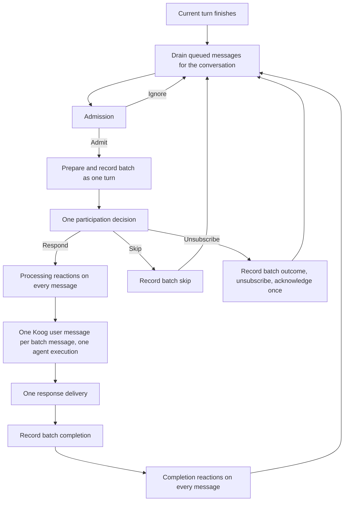
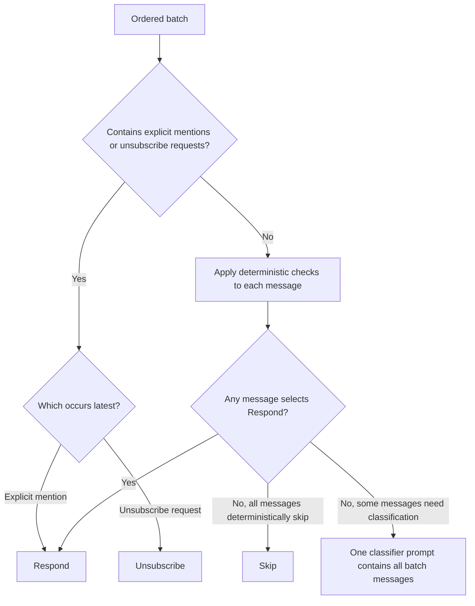

# Turn batching design

Status: implemented.

## Problem and goal

Messages can accumulate while Sidekick is processing a turn. The queue drains them together, but the coordinator processes each message as a separate turn. Sidekick can therefore produce separate replies to a request, its clarification, and its correction instead of considering them together.

The goal is to process all messages queued for the same conversation after the active turn finishes as one batch: one participation decision, one agent execution when a response is needed, and one response to the combined input.

```text
Queued: "Check production" → "Actually, staging" → "Only the API service"

Current: three separate turns, each potentially producing a reply
Target:  one turn considers all three messages and produces one response
```

## Queue and turn boundary

After a turn finishes, process all queued messages for the same conversation as one batch. Messages arriving during that batch wait for the next turn.



Successful turn completion includes delivery and persistence. The existing queue keys stay unchanged. Separate unthreaded Slack DM conversations remain separate.

The queue drains a batch and waits for `TurnCoordinator.run()` to return. The coordinator processes that batch as one turn:

```text
Before: drain [m1, m2, m3] → turn(m1) → turn(m2) → turn(m3)
Now:    drain [m1, m2, m3] → turn([m1, m2, m3])
```

`TurnCoordinator` calls `processIncoming` once with the drained message list. Queue keys remain unchanged.

### Consumer ownership: `IncomingMessageQueue`

`IncomingMessageQueue` owns serialization directly. Each queue entry holds pending messages and the original delivery context. The batch handler is supplied once at construction; production delegates to `TurnCoordinator`, while tests use a gated handler. An empty backlog does not imply an idle key.

```text
Absent -- enqueue --> Owned(backlog)
Owned  -- dispatch --> Owned(active batch, empty backlog)
Owned  -- enqueue --> append backlog
Owned  -- steering drain --> take backlog; retain owner and active batch
Owned  -- handler returns --> dispatch next batch, or release if empty
```

Enqueue, steering drains, batch-handle expiration, and empty-backlog ownership release use the same lock. Releasing ownership and observing an empty backlog are one atomic transition. A subsequent enqueue either reaches the existing consumer or acquires a new owner; it cannot fall between those operations.

Each handler receives a `SteeringInbox` valid only for that invocation. Its `drain()` takes pending messages in enqueue order and never releases ownership. A local active flag is cleared in the handler's `finally` block under the queue lock, so an expired inbox cannot consume later input. Consumer completion removes only its own entry, never a replacement consumer's entry.

Ordinary handler failures expire the inbox and continue with pending input; consumed input is not replayed. Scope shutdown expires inboxes and releases ownership. The queue remains in-memory, without durable message recovery.

Production currently ignores the steering inbox: messages still wait for the next turn. Koog steering is not wired yet. Its agreed semantics are to consume new input after the complete tool batch, keep requester identity unchanged throughout the turn, and leave messages arriving after the final drain for the next turn. Steering does not cancel tools or undo side effects. Subscription-command semantics remain undecided.

`IncomingMessageQueueDrainTest` exercises the queue directly, without the Sidekick agent pipeline: empty drains, ordered/exactly-once consumption, key isolation, expired inboxes, delivery context across ownership changes, handler failure, scope cancellation, concurrent producers, and enqueue racing with turn completion.

## Admission: `TurnAdmission`

`TurnAdmission` already accepts batches. All queued messages in an admitted batch remain in the turn input.

## Input preparation and session recording

Prepare each message's files and explicit skill invocation before recording the batch. The five-file limit applies per message, not per batch.

### Session recording: `SessionManager`

Keep messages individually persisted. Create one recorded turn for the batch and exclude every batch message ID from prior history to prevent duplicate prompt input after history seeding.

```text
SessionManager records batch
    ├── One session lock and one turn ID
    ├── Individual session messages: m1, m2, m3
    ├── Each retains its author, files, skill invocation, and mention status
    └── Prior history excludes m1, m2, m3
```

**Change:** make session recording accept batch input. The coordinator currently persists the aggregated admission mention flag on every message. Preserve each message's own mention status instead.

### Recorded input: `RecordedTurn`

Replace the singular `RecordedTurn.message` with the ordered batch of messages.

### Last-message target: `TurnContext`

Rename `TurnContext.currentMessageId` to `lastMessageId`. It identifies the latest message in the batch.

```text
TurnContext.lastMessageId = m3.id
    └── Agent-invoked tools target m3
```

`SlackReactionTools`, `ConversationIntelligenceLevelTools`, and `LoopTool` use `lastMessageId`. Scheduled and other singleton turns use their sole message's ID.

## Participation and subscription: `TurnParticipation`

Decide participation once. Any explicit mention makes `shouldReply` true unless a later unsubscribe request wins. Unsubscribe requests do not require an explicit mention.



| Batch order | Decision |
|---|---|
| Unsubscribe request, no explicit mentions | `Unsubscribe` |
| Explicit mention, no unsubscribe requests | `Respond` |
| Explicit mention → unsubscribe request | `Unsubscribe` |
| Unsubscribe request → explicit mention | `Respond` |

**Change:** make `TurnParticipationInput` batch-aware.

### Classifier input: `ParticipationClassifierInput`

Both classifiers receive one batch input. Per-message data is separate from shared conversation context:

```text
ParticipationClassifierInput
    ├── messages: ordered list of ParticipationClassifierMessage
    │       ├── text
    │       ├── author
    │       └── isExplicitMention
    ├── botUser
    ├── conversationId
    ├── messageHistory
    ├── hasAssistantHistory
    └── isPrivateMessage
```

`isPrivateMessage` is shared by the batch and used by the deterministic classifier. The LLM classifier does not use it.

### Deterministic checks: `DeterministicParticipationClassifier`

Apply deterministic checks to each message individually. After resolving explicit mentions and unsubscribe requests with the precedence above:

- If any message deterministically selects `Respond`, the whole batch selects `Respond`.
- If every message deterministically selects `Skip`, the batch selects `Skip`.
- Otherwise, classify the batch once with all messages in the LLM prompt.

A deterministic skip for one message does not discard another message's request. Do not apply single-message checks to concatenated batch text.

**Changes:** accept one batch input, compare subscription signals by message order, remove the mention requirement for unsubscribe, and apply deterministic checks per message using the shared context.

### LLM classification: `LlmParticipationClassifier`

When deterministic classification cannot decide the batch, make one LLM call with all batch messages. Include messages that individually received a deterministic skip; the LLM decides against the complete batch.

```text
Ordered inputs: [m1, m2, m3]
    │
    └── One classifier prompt
            ├── Instructions: decide whether to reply to the batch
            ├── Prior conversation context
            └── Current batch: m1, m2, m3 in order
                    │
                    └── One model call → one batch decision
```

**Contract:** `classify` accepts one `ParticipationClassifierInput` containing ordered messages and shared context.

**Prompt:** replace the latest-message-only input with the complete ordered batch. Update the system instructions to ask about the batch rather than only its last message. Preserve message boundaries and authors. Prior conversation context is shared by the batch and appears once.

The current batch is rendered inside `<current_messages>`. Each `<message>` has `author_id` and `author_name` attributes and contains the escaped message text. Shared history appears once under `<context>`.

The existing confidence threshold and classifier-failure handling apply to the single returned batch decision.

**Tests:** use the production LLM classifier and its prompt construction, replacing only model execution at the existing `executeClassifier` boundary. Inspect the generated prompt to verify that all provided messages appear in order and in the expected format. Test singleton and multi-message input. The separate delegation test mocks `LlmParticipationClassifier` to verify that `TurnParticipation` calls it.

## Lifecycle reactions: `TurnLifecycle`

Lifecycle reactions target every batch message when the participation decision is `Respond`:

```text
Processing → add eyes to all batch messages
Success    → replace eyes with white_check_mark on all batch messages
Failure    → remove eyes from all batch messages
```

The coordinator applies the existing `TurnLifecycle` methods to each message. Processing reactions precede agent execution. Completion reactions follow delivery and persistence. Agent-invoked reaction tools still target only `lastMessageId`.

## Agent execution: `SidekickAgent`

Execute Koog once for the batch.

### Requester and execution identity

```text
Distinct batch authors
    ├── One author       → that author is the requester and MCP execution identity
    └── Multiple authors → requester and MCP execution identity are null
```

Calls that require an identity may fail for multi-author batches. That is accepted behavior. Do not substitute the last message's author. Each message still includes its own author in the prompt.

### Koog user messages: `TurnPromptBuilder`

Each batch message becomes a separate Koog user message. All user messages are appended in order before the first model request, within one agent execution:

```text
RecordedTurn.messages: [m1, m2, m3]
    │
    └── TurnPromptBuilder
            │
            ├── User message 1: shared context, requester if present, m1
            ├── User message 2: m2
            └── User message 3: m3
                    │
                    └── One model request starts the agent loop
```

Each user message retains its author, current instruction, attachments, and explicit skill invocation. Requester metadata appears only in the first user message when the batch has one author. Multi-author batches omit requester metadata from every message. Prior history, skipped-message context, and the skills catalog appear only in the first message when applicable.

`SidekickAgent` passes the prepared message list to the strategy. The strategy appends every user message before requesting a model response. The complete batch is included whether or not Koog history already exists.

## Response delivery and turn completion

`ResponseDelivery` continues to receive one response. Count execution usage once.

### Turn completion: `SessionManager`

| Operation | Batch contract |
|---|---|
| `recordAssistantReply` | `originalMessageIds: List<String>` identifies all messages answered by the one reply |
| `markMessagesSkipped` | `messageIds: List<String>` identifies all messages receiving the same skip or failure reason |

Each operation updates the targeted messages under one session lock and saves once. Messages outside the supplied IDs retain their outcomes.

```text
Batch outcome
    ├── Respond     → mark m1, m2, m3 replied; store one assistant response
    ├── Skip        → record skip for m1, m2, m3
    ├── Unsubscribe → record outcome for m1, m2, m3; unsubscribe; acknowledge once
    └── Agent fails → record failure for m1, m2, m3; notify once
```

**Changes:** make turn-completion persistence operations batch-aware. Update the coordinator's completion and failure paths.

## Implementation sequence

First adjust interfaces and contracts to accept lists of messages wherever needed. Keep processing messages one-by-one during this stage, passing a singleton list for each message.

```text
1. List-based contracts, existing processing
       drain [m1, m2, m3]
           → turn([m1]) → turn([m2]) → turn([m3])

2. Gradually implement and test batch behavior
       participation, prompts, recording, completion, lifecycle reactions
       tested with [m1, m2, m3]
       production processing still passes singleton lists

3. Switch the coordinator to batch processing
       drain [m1, m2, m3]
           → turn([m1, m2, m3])
```

The final coordinator passes each drained batch as one list through preparation, recording, participation, execution, and completion. Scheduled turns continue to supply singleton lists.

## Implementation map

Paths below omit the shared `src/main/kotlin/com/github/uncomplexco/sidekick/` prefix within each module.

| Topic | Files |
|---|---|
| Queue and orchestration | `core/application/chat/IncomingMessageQueue.kt`, `core/application/turn/TurnCoordinator.kt` |
| Admission | `core/application/turn/TurnAdmission.kt` |
| Turn input | `core/application/turn/TurnContext.kt` |
| Recording and completion | `core/application/conversation/SessionManager.kt` |
| Participation and classifiers | `core/application/turn/TurnParticipation.kt` contains `TurnParticipation` and both classifiers |
| Agent execution and prompt | `core/application/agent/koog/SidekickAgent.kt`, `core/application/context/TurnPromptBuilder.kt` |
| Last-message tools | `tools/application/tools/slack/SlackReactionTools.kt`, `tools/application/tools/system/ConversationIntelligenceLevelTools.kt`, `tools/application/tools/system/LoopTool.kt` |

## Verification

```text
Hold turn A open
    → enqueue m1, m2, m3 in the same conversation
    → release A
    → assert turn B receives [m1, m2, m3], executes once, delivers once
    → enqueue m4 while B runs
    → assert m4 belongs to the following turn
```

| Behavior | Expected result |
|---|---|
| Explicit mention and unsubscribe in either order | Latest signal determines the branch |
| One deterministic `Respond` | Batch responds |
| All deterministic skips | Batch skips |
| LLM delegation | `TurnParticipation` calls the LLM classifier |
| Classifier prompt | Every batch message appears in order and in the expected format |
| Koog input | Consecutive user messages preserve batch order, authors, files, and skill invocations before one model request |
| Requester metadata | Present only in the first user message for a single-author batch, omitted for multi-author batches |
| History seeding | Current batch messages do not also appear in prior history |
| Completion or agent failure | Every batch message receives the outcome |
| Lifecycle reactions | Every batch message receives the appropriate reaction change |
| Execution usage | Counted once |
| Agent-invoked reaction tools | Target `lastMessageId` |
| Separate conversations | Process independently |
| Singleton input | Remains supported |
